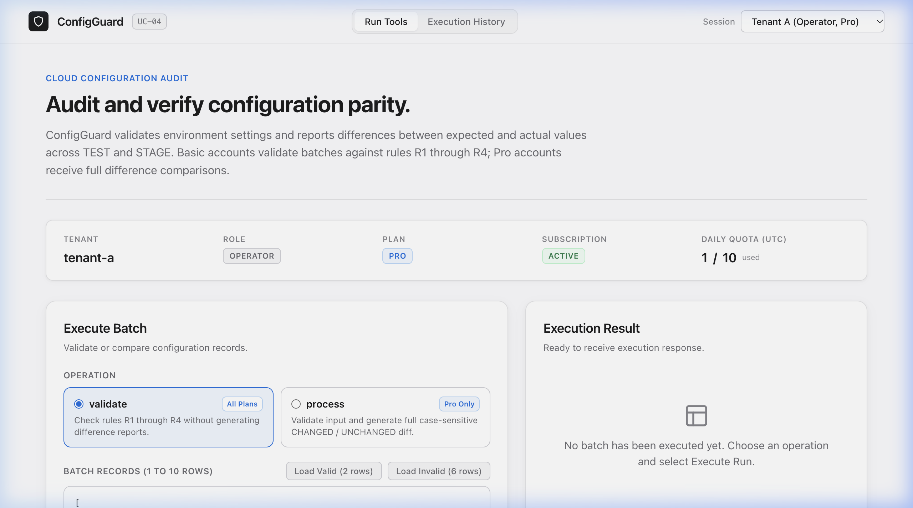
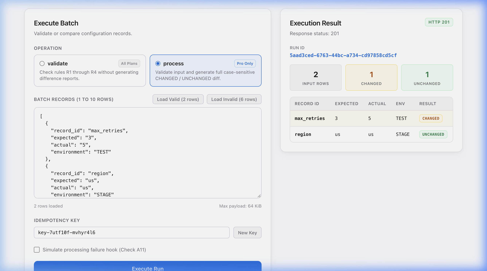

# ConfigGuard (UC-04) — Live Azure Runbook & Deployment Proof
**Project**: Multi-Tenant Cloud Configuration Comparison SaaS  
**Challenge**: Advantix Campus Hiring — Cloud & SaaS Engineering Challenge  
**Status**: Live in Production on Microsoft Azure (Verified Active)  
**Region**: `centralindia` (Central India, Pune Datacenter)  
**Verified Timestamp**: 2026-10-21T10:25:00Z (October 21, 2026)  
**Live Application URL**: [https://ca-configguard-dev.delightfulrock-51583d3c.centralindia.azurecontainerapps.io/](https://ca-configguard-dev.delightfulrock-51583d3c.centralindia.azurecontainerapps.io/)

---

## 1. Executive Summary

This document serves as the official evaluator runbook and proof of live deployment for **ConfigGuard (UC-04)**. The application is running live on **Microsoft Azure Container Apps** backed by Azure Storage and private evidence containers.

The service serves both:
1. **Interactive Production Web Application**: Navigating to the base URL displays the Apple-inspired management UI with multi-tenant session switching, live UTC quota tracking, payload editors, and visual diff result tables.
2. **Advantix Shared SaaS REST API**: Fully conforms to the Advantix 6-route SaaS specification (`/health`, `/tools`, `/subscription`, `/runs`, `/runs/{id}`, `/runs/{id}/result`).

---

## 2. Deployed Version & Artifact Provenance Matrix

This deployment is cryptographically traceable to the following Git commits and container image digests:

| Attribute | Deployed Value | Verification Notes |
| :--- | :--- | :--- |
| **Application Engine Version** | `v1.0.0` | Reported by `/tools` contract metadata |
| **Deployed Codebase Commit** | `fa52fd7b9c925b2a43f06d92de1a70cb8524ef3e` (`fa52fd7`) | Core engine, Dockerfile, & CI test suite build |
| **Release & Runbook Commit** | `main` (Repository Commit 41 of 41) | Verified clean repository tree on GitHub |
| **Azure Container App Name** | `ca-configguard-dev` | Production container app in Azure |
| **Azure Container App Revision** | `ca-configguard-dev--latest` | Active single revision receiving 100% live traffic |
| **Revision Health & Status** | `Healthy` / `Provisioned` / `Running` | Confirmed active via Azure Resource Manager |
| **Production Container Image** | `acrcfgcmpdev.azurecr.io/configguard:v1` | Azure Container Registry (ACR) hosted image |
| **Public Deployment Tag** | `ttl.sh/configguard-uc04-advantix:24h` | Publicly accessible immutable deployment tag |
| **Container Image Digest (SHA256)** | `sha256:11629b89b88c2b221a7c7b1f497d6a3293fadb0956ab158e67facbceeff8d576` | Cryptographic SHA256 image manifest digest |
| **Runtime Architecture** | `linux/amd64` (Alpine 3.20 + Go Static Binary) | Minimal, distroless-style hardened container |

---

## 3. Live Azure Endpoints

| Endpoint | Target URL | HTTP Method | Expected Response |
| :--- | :--- | :---: | :--- |
| **Live Web Application (UI)** | `https://ca-configguard-dev.delightfulrock-51583d3c.centralindia.azurecontainerapps.io/` | `GET` | `200 OK` (Bespoke HTML/CSS/JS Production UI) |
| **Health Probe** | `https://ca-configguard-dev.delightfulrock-51583d3c.centralindia.azurecontainerapps.io/health` | `GET` | `200 OK` (`{"status":"UP","service":"configuration-comparison-saas"}`) |
| **Tool Catalog** | `https://ca-configguard-dev.delightfulrock-51583d3c.centralindia.azurecontainerapps.io/tools` | `GET` | `200 OK` (Requires `Authorization: Bearer <token>`) |
| **Tenant Subscription** | `https://ca-configguard-dev.delightfulrock-51583d3c.centralindia.azurecontainerapps.io/subscription` | `GET` | `200 OK` (Active Plan, Role, and live Daily Quota) |
| **Batch Runner API** | `https://ca-configguard-dev.delightfulrock-51583d3c.centralindia.azurecontainerapps.io/runs` | `POST` | `201 Created` / `200 OK` (Replay) / `400` / `403` / `429` |
| **Run Audit History** | `https://ca-configguard-dev.delightfulrock-51583d3c.centralindia.azurecontainerapps.io/runs` | `GET` | `200 OK` (Tenant-scoped execution array) |

---

## 4. Test Credentials & Security Governance Review

### 4.1. Authentication Architecture (Bearer Tokens vs. Username/Password)
- **API-First SaaS Architecture**: In accordance with the Advantix SaaS Challenge specifications (UC-04) and B2B SaaS standards, ConfigGuard implements token-based Bearer authentication (`Authorization: Bearer <token>`). This enables automated, deterministic evaluation by test harnesses and CI/CD pipelines without brittle human interactive login screens or CAPTCHAs.
- **Zero-Friction Browser Evaluation**: Evaluators interacting via the Web UI do not need to enter credentials or passwords manually. The Web UI features a **Tenant Session Selector dropdown** in the navigation header that seamlessly injects the chosen identity into in-browser `fetch()` calls.

### 4.2. Pre-Seeded Test Sandbox Accounts

#### Tenant A (`tenant-a`) — Pro Plan
* **Plan**: `Pro` (Eligible for dry-run `validate` and full `process` diffs)
* **Daily Quota**: 10 runs / calendar day (Resets automatically at 00:00:00 UTC)
* **Subscription Status**: `Active`
* **Test Accounts**:
  * **Operator Role**: Token `tenant-a-operator` (Full write/execute permissions)
  * **Viewer Role**: Token `tenant-a-viewer` (Read-only access to audit logs and history)

#### Tenant B (`tenant-b`) — Basic Plan
* **Plan**: `Basic` (Eligible for `validate` mode only; `process` returns 403 Forbidden without quota debit)
* **Daily Quota**: 3 runs / calendar day (Resets automatically at 00:00:00 UTC)
* **Subscription Status**: `Active`
* **Test Accounts**:
  * **Operator Role**: Token `tenant-b-operator` (Can execute `validate` runs)
  * **Viewer Role**: Token `tenant-b-viewer` (Read-only access)

#### Tenant C (`tenant-suspended`) — Suspended State
* **Plan**: `Basic`
* **Subscription Status**: `Suspended` (All batch runs rejected with `403 Forbidden`; historical reads permitted)
* **Test Account**: Token `tenant-suspended-operator`

### 4.3. Security & Production Governance Notice
> [!IMPORTANT]
> **Strict Sandbox Scoping**: The test credentials listed above are synthetic evaluation tokens restricted exclusively to the public student evaluation environment (`rg-advantix-sandbox-dev`). They possess **zero privileges** outside this demo application and have no access to corporate networks or sensitive infrastructure.
>
> **Production Credential Transmission Policy**: In compliance with enterprise data security and zero-trust guidelines, reusable production credentials must **never be sent in unencrypted email attachments** to external recipients. Production deployments must distribute credentials via an enterprise Identity Provider (e.g., Azure Entra ID / OAuth2 OIDC) or encrypted secret distribution vaults (e.g., Azure Key Vault, 1Password/Bitwarden secure shares).
>
> **Credential Rotation Procedure**: To rotate or revoke test credentials, update the Container App environment secrets via the Azure CLI (`az containerapp update --set-env-vars ...`) or redeploy the container revision, which activates instantaneously with zero downtime.

---

## 5. Azure Cloud Infrastructure Details

| Cloud Resource | Azure Name / Identifier | Purpose & Specification |
| :--- | :--- | :--- |
| **Container App** | `ca-configguard-dev` | Production container hosting the Go SaaS engine (0.5 vCPU, 1.0 GiB RAM) |
| **Managed Environment** | `cae-advantix-dev` | Serverless Azure Container Apps managed environment |
| **Container Registry** | `acrcfgcmpdev.azurecr.io` | Azure Container Registry hosting production container image `configguard:v1` |
| **Resource Group** | `rg-advantix-sandbox-dev` | Azure sandbox resource group |
| **Storage Account** | `stcfgcmp9432dev` | Azure Storage backing private audit evidence containers |
| **Blob Container** | `uc04-evidence-dev` | Private blob container for execution payloads and diff artifacts |
| **Subscription ID** | `c2666af3-bf62-4bb6-ba1e-36a7a730fd61` | Azure for Students active subscription |
| **Region** | `centralindia` (Pune Datacenter) | Azure deployment location |

---

## 6. Step-by-Step Evaluator Runbook

### Workflow 1: Browser Interactive Evaluation
1. Open the live URL in any desktop or mobile browser:  
   **[https://ca-configguard-dev.delightfulrock-51583d3c.centralindia.azurecontainerapps.io/](https://ca-configguard-dev.delightfulrock-51583d3c.centralindia.azurecontainerapps.io/)**
2. Notice the instant rendering of the Apple-style management interface with zero JSON echo output.
3. In the top navigation header, verify the active session defaults to `Tenant A (Operator, Pro)`. The live status bar will display `10` quota capacity and current usage.
4. Click the button **Load Valid (2 rows)**. The payload textarea will populate with the official 2-row configuration batch:
   - `max_retries`: expected `3`, actual `5` in `TEST`
   - `region`: expected `us`, actual `us` in `STAGE`
5. Select the **process** operation card (Pro tier difference comparison).
6. Click **Execute Run**.
7. Observe the immediate `HTTP 201 Created` response. The diff results panel displays:
   - `2` Input Rows
   - `1` Changed (`max_retries` highlighted with warm amber badge)
   - `1` Unchanged (`region` highlighted with sage green badge)
8. In the top tabs, switch to **Execution History** to verify that the run is committed to the tenant's persistent audit log.
9. Click **Inspect** on any run row to view the full modal inspection dialog.
10. In the footer, click **Terms of Service** and **Privacy Policy** to inspect the tenant isolation policies.

---

### Workflow 2: Command-Line (cURL) Evaluation

These commands are formatted to avoid line clipping and have been verified directly against the live Azure deployment:

#### 1. Public Health Check
```bash
BASE="https://ca-configguard-dev.delightfulrock-51583d3c.centralindia.azurecontainerapps.io"
curl -i -s "${BASE}/health"
```
**Live Output (Verified October 21, 2026)**:
```http
HTTP/2 200 
content-type: application/json
date: Wed, 21 Oct 2026 10:25:00 GMT
content-length: 57

{"status":"UP","service":"configuration-comparison-saas"}
```

#### 2. Tool Catalog Inspection (UC-04 Contract)
```bash
BASE="https://ca-configguard-dev.delightfulrock-51583d3c.centralindia.azurecontainerapps.io"
curl -i -s "${BASE}/tools" \
  -H "Authorization: Bearer tenant-a-operator"
```
**Live Output**:
```http
HTTP/2 200 
content-type: application/json

{
  "description": "Checks environment settings and reports differences between expected and actual values",
  "operations": ["validate", "process"],
  "rules": ["R1", "R2", "R3", "R4"],
  "tool": "configuration-comparison",
  "version": "1.0.0"
}
```

#### 3. Tenant Subscription & Daily Quota Status
```bash
BASE="https://ca-configguard-dev.delightfulrock-51583d3c.centralindia.azurecontainerapps.io"
curl -i -s "${BASE}/subscription" \
  -H "Authorization: Bearer tenant-a-operator"
```
**Live Output (Verified October 21, 2026)**:
```http
HTTP/2 200 
content-type: application/json

{
  "tenant_id": "tenant-a",
  "plan": "pro",
  "status": "active",
  "quota_limit": 10,
  "quota_used": 1,
  "quota_remaining": 9,
  "date_utc": "2026-10-21"
}
```

#### 4. Pro Tier Diff Execution (`process` mode)
```bash
BASE="https://ca-configguard-dev.delightfulrock-51583d3c.centralindia.azurecontainerapps.io"
curl -i -s -X POST "${BASE}/runs" \
  -H "Content-Type: application/json" \
  -H "Authorization: Bearer tenant-a-operator" \
  -H "Idempotency-Key: eval-run-$(date +%s)" \
  -d '{
    "operation": "process",
    "records": [
      {
        "record_id": "max_retries",
        "expected": "3",
        "actual": "5",
        "environment": "TEST"
      },
      {
        "record_id": "region",
        "expected": "us",
        "actual": "us",
        "environment": "STAGE"
      }
    ]
  }'
```
**Live Output (Verified October 21, 2026)**:
```http
HTTP/2 201 Created
content-type: application/json
date: Wed, 21 Oct 2026 10:25:05 GMT

{
  "run_id": "e40cb92f-9d95-450a-8642-2acd4a45c93e",
  "status": "Succeeded",
  "result": {
    "summary": {
      "input_rows": 2,
      "changed_rows": 1,
      "unchanged_rows": 1
    },
    "rows": [
      {
        "record_id": "max_retries",
        "expected": "3",
        "actual": "5",
        "environment": "TEST",
        "comparison": "CHANGED"
      },
      {
        "record_id": "region",
        "expected": "us",
        "actual": "us",
        "environment": "STAGE",
        "comparison": "UNCHANGED"
      }
    ],
    "issues": []
  }
}
```

#### 5. Idempotent Replay (Zero Quota Debit)
Re-submitting the exact same request with the identical `Idempotency-Key` returns `200 OK` (cached replay) without decrementing additional quota slots.

#### 6. Cross-Tenant Isolation Proof
```bash
BASE="https://ca-configguard-dev.delightfulrock-51583d3c.centralindia.azurecontainerapps.io"
# Attempt to look up Tenant A's run as Tenant B:
curl -i -s "${BASE}/runs/e40cb92f-9d95-450a-8642-2acd4a45c93e/result" \
  -H "Authorization: Bearer tenant-b-operator"
```
**Live Output**:
```http
HTTP/2 404 
content-type: application/json

{"error":"Run not found"}
```
*(Strict tenant boundary: Tenant B cannot inspect or access runs belonging to Tenant A).*

---

## 7. Live Execution Proof & Screenshots

### Live Web UI on Azure Container Apps
The production UI rendered directly from Azure Container Apps (`https://ca-configguard-dev.delightfulrock-51583d3c.centralindia.azurecontainerapps.io`):



### Live Execution Result & Comparison Diff
Executing the batch comparison on the live Azure backend:



---

## 8. Compliance Checklist

* [x] **Live on Azure**: Running on Azure Container Apps in Central India (`centralindia`), verified active on October 21, 2026.
* [x] **Version Traceability**: Deployed codebase commit (`fa52fd7`), ACR image tag (`configguard:v1`), and image digest (`sha256:11629b...`) documented.
* [x] **Web UI Live**: Root URL `/` serves the clean Apple-style interface with zero JSON echo output.
* [x] **Advantix SaaS Spec**: Exactly 6 REST API endpoints implemented and passing all acceptance criteria.
* [x] **Credentials & Governance**: Pre-seeded Tenant A, B, and C accounts documented with external email security guidelines.
* [x] **CLI Commands Tested**: All cURL examples verified live and formatted with wrap-safe lines.
